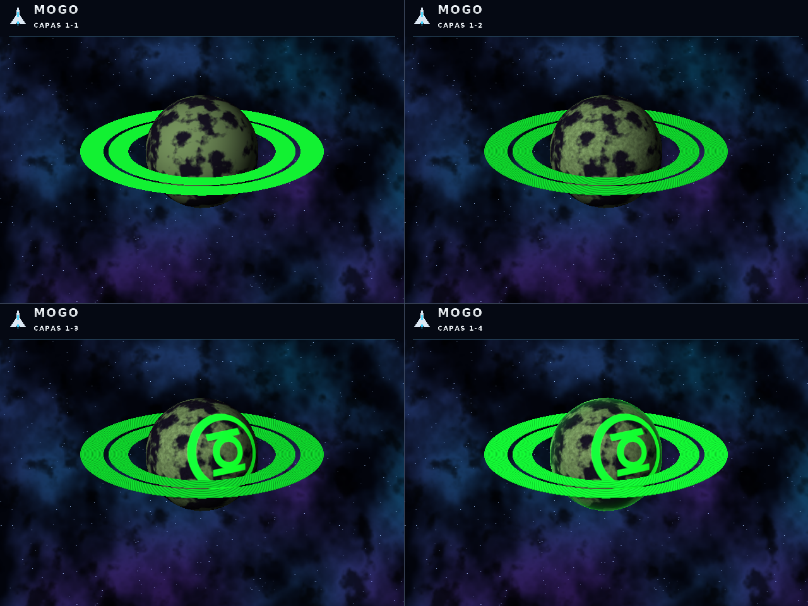
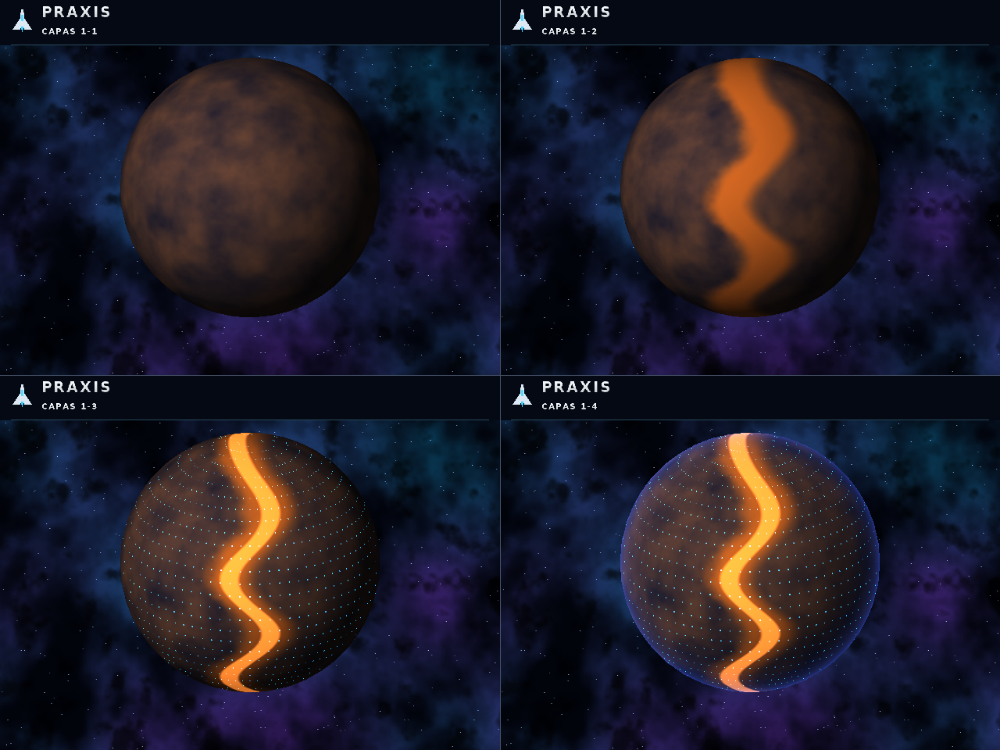
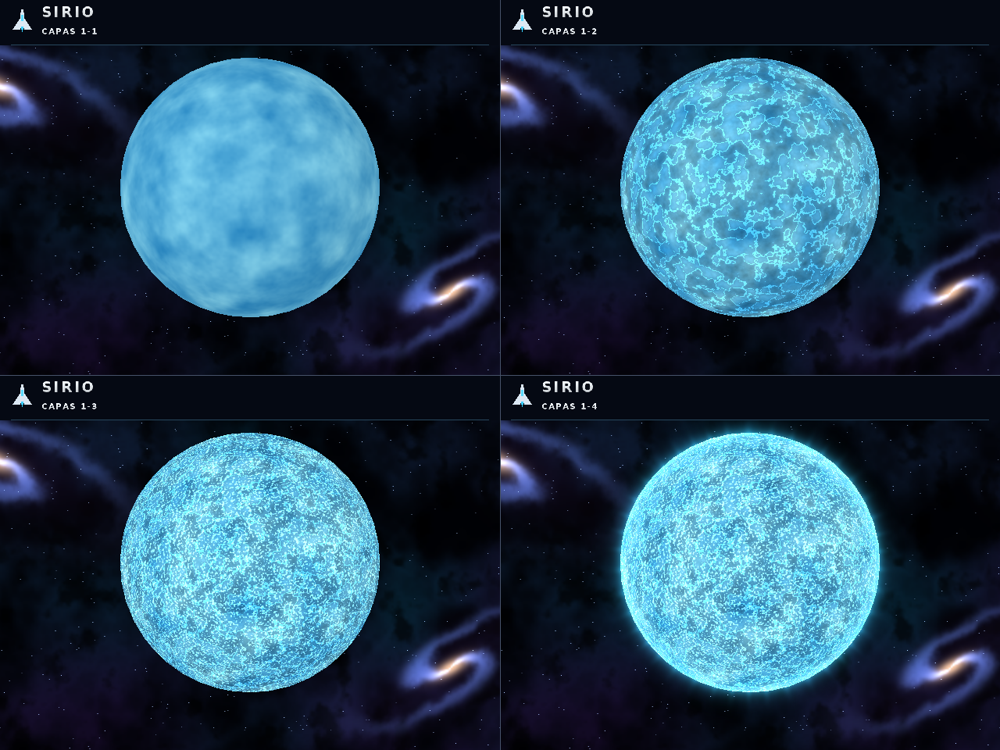
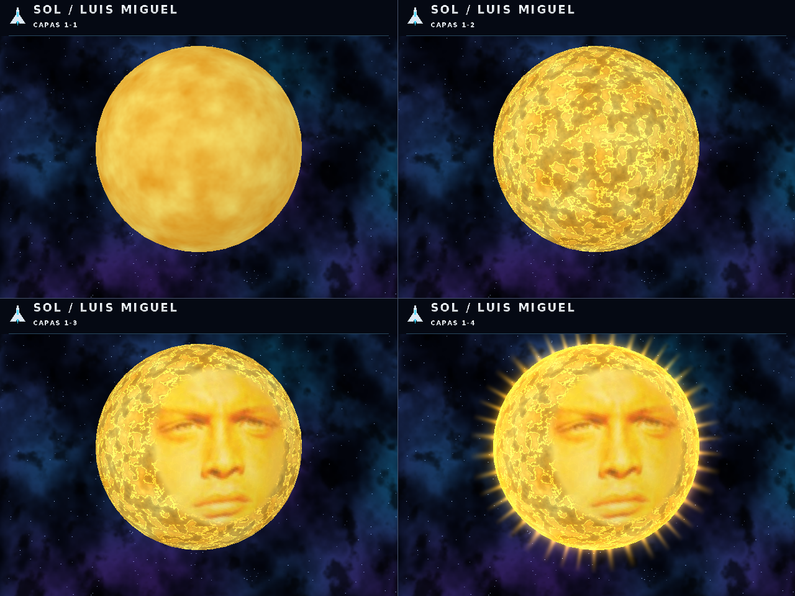
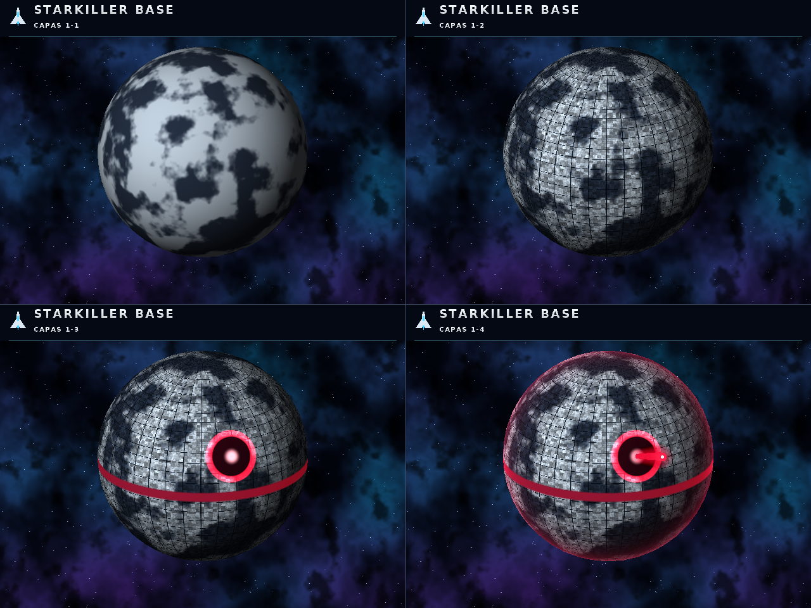
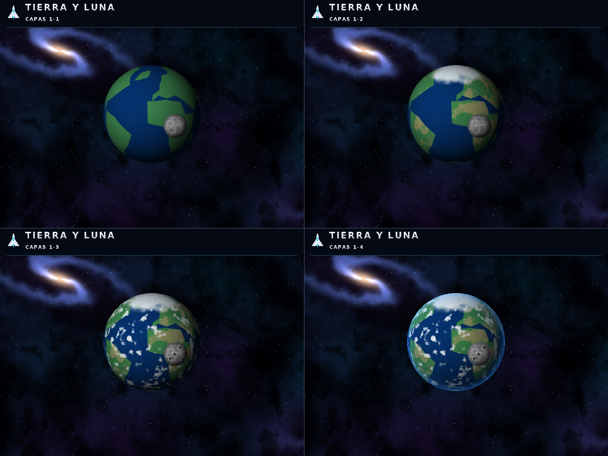
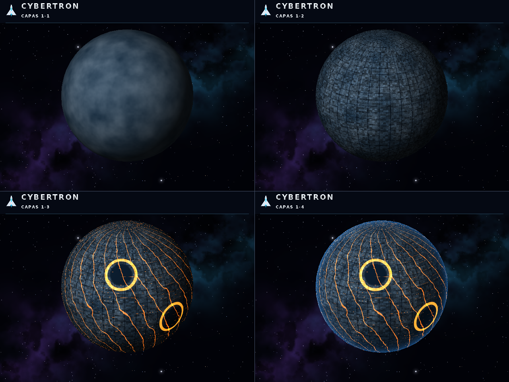

# LAB5 — Mogo, Cybertron, Praxis, Sirio, Sol, Starkiller y Tierra

--
## Planetas hechos
















--

## Ejecutar

Requiere Rust estable con soporte para la edición 2024 (Rust 1.85 o posterior), Cargo y un entorno gráfico para la ventana. En Windows basta la instalación habitual de Rust y sus herramientas de compilación. En Linux pueden hacer falta las bibliotecas de desarrollo de X11/Wayland que utiliza minifb.

Desde esta carpeta, donde está `Cargo.toml`:

```sh
cargo run --release
```

## Controles

| Tecla | Función |
|---|---|
| 1–7 | Mogo, Cybertron, Praxis, Sirio, Sol, Starkiller, Tierra |
| Tab | Siguiente cuerpo; reinicia cámara y tiempo |
| C | Cambia entre 1, 2, 3 y 4 capas acumulativas |
| V | Alterna entre vista individual y comparación de las cuatro capas |
| P | Exporta la comparación 2×2 a `screenshots/capas-NOMBRE.png` |
| S | Exporta exactamente el framebuffer visible a `screenshots/captura.png` |
| Espacio | Pausa o reanuda el planeta y la órbita lunar; el fondo tiene su pausa independiente |
| B | Cambia fondo: clásico → nebulosas → galaxias espirales |
| F | Congela o reanuda el fondo sin alterar el planeta |
| Flechas | Orbita la cámara alrededor de la escena |
| E | Activa/desactiva anillos de Mogo, Luna o rayo de Starkiller |
| H | Activa/desactiva la malla holográfica, conservando el control de `main` |
| T | Muestra/oculta títulos en la vista individual |
| R | Reinicia cámara, tiempo del planeta y tiempo del fondo |
| Esc | Cierra la ventana |

En la comparación, los paneles siempre están rotulados: arriba izquierda 1 capa; arriba derecha 2; abajo izquierda 3; abajo derecha 4. La cámara y el tiempo son idénticos en los cuatro paneles. El fondo usa también el mismo instante en todos ellos y cada título incluye el emblema de nave.

## Exportar sin abrir ventana

Una escena final:

```sh
cargo run --release -- --solo-render --escena tierra --tiempo 6 --salida renders/tierra.png
```

Comparación de capas:

```sh
cargo run --release -- --escena cybertron --comparar-capas --salida renders/capas-cybertron.png
```

Las siete escenas finales y sus siete comparaciones, a un tiempo reproducible:

```sh
cargo run --release -- --screenshots --tiempo 0
```

Este último comando genera **14 PNG** dentro de `screenshots/`. Si se especifica `--salida renders/captura.png`, usa la carpeta `renders/` para los 14 archivos y conserva sus nombres por cuerpo.

Otros ejemplos:

```sh
cargo run --release -- --escena sol --pausado
cargo run --release -- --solo-render --escena praxis --capas 2 --ancho 960 --alto 720 --sin-titulos --salida renders/praxis-capa2.png
cargo run --release -- --escena tierra --fotogramas 120
cargo run --release -- --help
```

`--escena` acepta `mogo`, `cybertron`, `praxis`, `sirio`, `sol`, `starkiller`, `tierra`; también `sirius`, `sun` y `earth`. Las opciones principales tienen los alias en inglés del proyecto de shaders: `--scene`, `--render-only`, `--layer-sheet`, `--layers`, `--width`, `--height`, `--time`, `--output`, `--paused`, `--no-hud`, `--frames`.

Dimensiones permitidas: 160–4096 píxeles por eje. Se rechazan capas fuera de 1–4, tiempos no finitos, parámetros sin valor y opciones desconocidas. Un render sin ventana no necesita servidor gráfico; la compilación conserva las dependencias nativas de minifb.

## Fondo espacial y tipografía

- **Clásico:** conserva el fondo original y siempre es estático.
- **Nebulosas:** nubes violetas/cian con desplazamiento continuo, deformación suave y estrellas con parallax.
- **Galaxias:** galaxias espirales inclinadas que cruzan el campo de visión, con núcleos cálidos, brazos azules y estrellas.

`B` cambia el paisaje y `F` lo congela en el punto actual o reanuda su movimiento. `Espacio` controla solo los cuerpos, de modo que puedes dejar un planeta quieto mientras el espacio fluye detrás. El fondo mantiene su tiempo al cambiar de cuerpo. `R` reinicia ambos relojes.

Los fondos son panoramas procedurales: se precalculan una vez y luego se muestrean con interpolación bilineal, sin regenerar ruido por píxel en cada fotograma. La unión horizontal del panorama es continua. La velocidad real depende del rendimiento del renderizador por CPU.

```sh
cargo run --release -- --fondo galaxias
cargo run --release -- --fondo nebulosas --fondo-estatico
cargo run --release -- --fondo galaxias --pausado
cargo run --release -- --solo-render --escena sirio --fondo galaxias --tiempo-fondo 12 --salida renders/sirio-galaxias.png
cargo run --release -- --escena mogo --comparar-capas --fondo nebulosas --tiempo-fondo 8 --salida renders/capas-mogo.png
```

Configuración de fondo: `--fondo clasico|nebulosas|galaxias` (`--background`), `--fondo-estatico`, `--fondo-fluido` y `--tiempo-fondo N`. Sin `--tiempo-fondo`, el reloj del fondo toma el valor inicial de `--tiempo`. Las exportaciones son instantáneas PNG reproducibles del tiempo indicado; para ver movimiento se utiliza la ventana.

Los títulos y controles utilizan un atlas de glifos incorporado, derivado de DejaVu Sans Bold, con acabado plateado y espaciado geométrico inspirado en MIB. No requiere fuentes instaladas ni dependencias nuevas. El icono de nave se dibuja en el framebuffer y aparece tanto en la vista individual como en los cuatro títulos de la comparación y sus PNG. La licencia de la fuente está en `assets/FONT_LICENSE.txt`.

## Shaders y etapas

Cada etapa se suma a las anteriores; **4 es el diseño final**.

| Cuerpo | 1: base | 2: estructura | 3: identidad | 4: acabado |
|---|---|---|---|---|
| Mogo | Superficie verde oscura | Vegetación y variación mineral | Emblema de Linterna Verde emisivo | Borde verde luminoso |
| Cybertron | Metal azul/acero | Placas y juntas mecánicas | Circuitos naranjas y estructuras concéntricas | Resplandor azul periférico |
| Praxis | Corteza azul/marrón | Fractura naranja irregular | Retícula de puntos azules y fisura pulsante | Borde de energía azul |
| Sirio | Fotosfera azul/cian | Turbulencia de plasma | Granulación caliente animada | Corona y halo cian |
| Sol | Fotosfera dorada | Plasma animado | Cara de Luis Miguel de la referencia | Rayos y corona dorada |
| Starkiller Base | Corteza fría y nieve | Placas mecánicas | Trinchera y apertura roja | Rayo 3D y emisión roja |
| Tierra | Océanos y siluetas de continentes | Relieve por color y casquetes | Nubes en movimiento | Atmósfera azul |

Son interpretaciones estilizadas sobre esferas; los shaders de superficie no desplazan los vértices. Praxis sigue la retícula y la fractura de la referencia. Starkiller sigue la versión nevada con arma roja de la imagen. No se requiere un modelo detallado de la Estrella de la Muerte.

La Tierra usa contornos geográficos simplificados definidos en código, sin mapas externos. La Luna es una malla separada, con cráteres procedurales, radio 0.24, órbita de radio 1.60 y periodo aproximado de 28.6 segundos. Comparte proyección y z-buffer con la Tierra para poder pasar delante y detrás.

La cara del Sol corresponde al meme de luis miguel y se proyecta sobre el hemisferio frontal de la esfera, por lo que gira con ella. `assets/luis_miguel.png` muestra el recorte y `assets/luis_miguel.rgb` contiene los mismos píxeles RGB a 192×200, incorporados con `include_bytes!`. El retrato es la única textura: el resto de superficies y efectos son procedurales. 

## Estructura

```text
Cargo.toml / Cargo.lock
models/                 OBJ originales de main
assets/                 Retrato del Sol, atlas de fuente, licencia y créditos
src/
  main.rs               Entrada y módulos
  app.rs                CLI, ventana, capas, comparación y exportación
  scene.rs              OBJ, proyección, órbita, anillos, corona y rayo
  shaders.rs            Siete shaders y shaders auxiliares
  hud.rs                Tipografía espacial plateada, nave y títulos adaptativos
  camera.rs             Cámara de main
  color.rs              Color de main
  cosmos.rs             Fondo clásico y panoramas fluidos de nebulosas/galaxias
  framebuffer.rs        Framebuffer, profundidad y PNG de main
  obj.rs                Lectura de OBJ de main
  triangle.rs           Rasterización y holograma de main
tests/cli.rs            Pruebas de CLI y exportación PNG
screenshots/            Destino de exportaciones

```

## Validación

```sh
cargo test --locked
cargo build --release --locked
```

